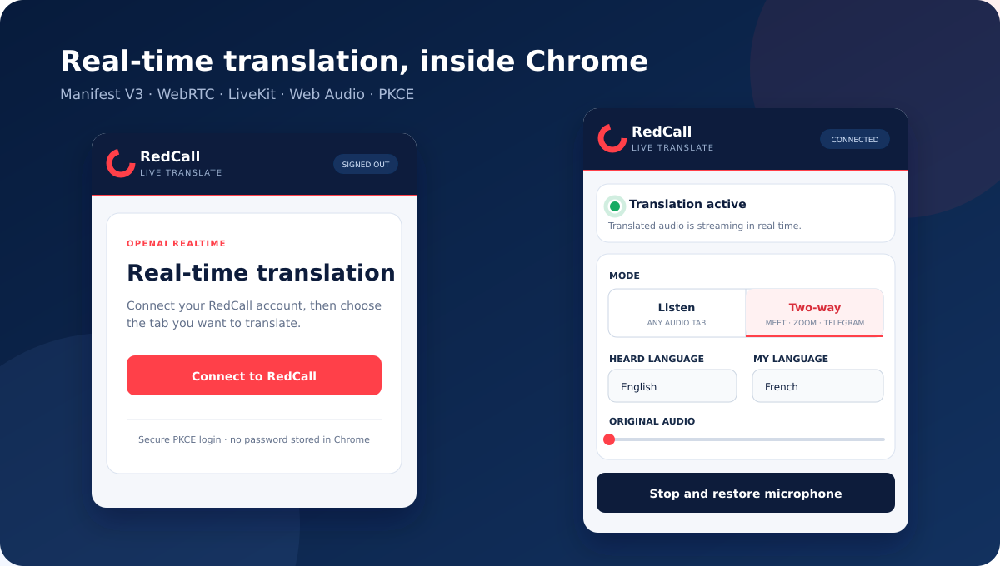
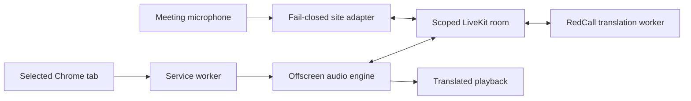

<div align="center">
  

# RedCall Live Translate

**Real-time voice translation for Chrome tabs and browser-based meetings.**

[](https://developer.chrome.com/docs/extensions/develop/migrate/what-is-mv3)
[](manifest.json)
[](https://developer.mozilla.org/docs/Web/JavaScript)
[](.github/workflows/validate.yml)
[](LICENSE.md)

[Documentation française](docs/README.fr.md) · [Architecture](docs/architecture.md) ·
[Security](SECURITY.md)

</div>



## Overview

RedCall Live Translate is a Chrome Manifest V3 extension that captures audio from a user-selected
tab, sends it to an ephemeral RedCall translation session over LiveKit, and plays the translated
voice with low latency.

For supported browser meeting clients, the bidirectional mode also replaces the outgoing microphone
track with translated speech. The adapter is deliberately **fail-closed**: if translation becomes
unavailable, raw microphone audio is not silently restored or leaked to the call.

> [!IMPORTANT] This repository contains the browser client used for portfolio and technical review.
> The RedCall API and translation worker are separate services and are required for an end-to-end
> session. Provider credentials and server-side code are not included.

## Engineering highlights

- Chrome Manifest V3 architecture with a service worker, side panel, offscreen document, and
  isolated/main-world content scripts.
- Authorization Code flow with PKCE, short-lived access tokens, rotating refresh sessions, and
  per-device identifiers.
- Real-time WebRTC audio transport through scoped LiveKit rooms.
- Web Audio preprocessing: high-pass filtering, presence EQ, compression, output limiting, and
  automatic ducking.
- Explicit per-tab capture lifecycle with cleanup of media tracks, timers, audio contexts, and
  rooms.
- Bidirectional WebRTC track replacement with original-track restoration on explicit stop.
- Least-privilege host allowlist and a strict extension-page Content Security Policy.
- Dependency-light runtime: the extension is plain HTML, CSS, and JavaScript; LiveKit is vendored
  with its upstream license.

## Capabilities

| Mode              | Browser target                    | Audio path                             | Status                                  |
| ----------------- | --------------------------------- | -------------------------------------- | --------------------------------------- |
| Listen translated | Any Chrome tab that exposes audio | Tab → RedCall → user                   | Implemented                             |
| Bidirectional     | Google Meet                       | Tab + microphone ↔ RedCall ↔ meeting | Implemented                             |
| Bidirectional     | Zoom Web regional domains         | Tab + microphone ↔ RedCall ↔ meeting | Beta; real-call validation pending      |
| Bidirectional     | Telegram Web K and A              | Tab + microphone ↔ RedCall ↔ meeting | Beta; clients must be tested separately |
| Listen translated | WhatsApp Web                      | Tab → RedCall → user                   | Supported through generic tab capture   |

The interface exposes 12 source/target language choices. Actual voices and language availability are
returned by the translation provider configured on the RedCall server.

## Architecture



See [docs/architecture.md](docs/architecture.md) for the session lifecycle, trust boundaries, and
component responsibilities.

## Local installation

### Requirements

- Google Chrome 116 or newer.
- Node.js 22 or newer for repository validation only.
- Access to a compatible RedCall API deployment and a RedCall account.

### Run from source

Clone this repository, then run:

```bash
cd redcall-live-translate
npm ci
npm run validate
```

Then:

1. Open `chrome://extensions`.
2. Enable **Developer mode**.
3. Select **Load unpacked** and choose the repository root.
4. Pin **RedCall Live Translate**.
5. Open the tab to translate and click the extension icon.
6. Sign in to RedCall and start a session.

The default API endpoint is `https://redcall.tech/redcall-api`. A different compatible endpoint can
be configured under **Server** in the side panel.

## Development commands

| Command                | Purpose                                                                         |
| ---------------------- | ------------------------------------------------------------------------------- |
| `npm run format`       | Format source and documentation with Prettier                                   |
| `npm run format:check` | Verify formatting without changing files                                        |
| `npm run check:syntax` | Parse all first-party JavaScript with Node                                      |
| `npm test`             | Validate the manifest, referenced assets, permissions, CSP, and secret patterns |
| `npm run validate`     | Run every repository quality gate                                               |

## Project structure

```text
.
├── manifest.json          # Chrome MV3 declaration and permissions
├── service-worker.js      # Side-panel launch and capture orchestration
├── sidepanel.*            # Authentication, session controls, and UI
├── offscreen.*            # Web Audio graph and LiveKit media transport
├── content-bridge.js      # Isolated-world messaging bridge
├── site-adapter.js        # Main-world WebRTC track replacement
├── mic-permission.*       # Explicit microphone permission flow
├── assets/                # Extension brand assets and icons
├── vendor/                # Browser runtime dependency and upstream license
├── docs/                  # Architecture and French documentation
└── tests/                 # Dependency-free repository validation
```

## Security and privacy

- No OpenAI, ElevenLabs, or LiveKit service secret is embedded in the extension.
- The RedCall password is entered on the RedCall origin and is never given to the extension.
- Translation rooms and browser participant tokens are short-lived and server-scoped.
- Audio capture starts only after a user gesture and explicit Chrome permission.
- The client stops tracks and disconnects rooms when the session is ended.
- This client does not implement audio recording or transcript persistence.

The main-world meeting adapter necessarily receives a short-lived, subscribe-only room token. The
backend must keep its TTL and room grants minimal. See [SECURITY.md](SECURITY.md) before deploying
changes.

## Known limitations

- Native Zoom, Microsoft Teams, Telegram, and WhatsApp applications cannot be captured by a Chrome
  extension.
- Browser meeting providers can change internal WebRTC behavior without notice; adapters require
  regression testing.
- The `desktopCapture` fallback cannot mute the original tab audio, so headphones are recommended.
- Bidirectional Zoom support is implemented but has not yet been validated on a production Zoom
  call.
- WhatsApp Web is intentionally listen-only in this release.

## Roadmap

- Automated Chrome smoke tests for the unpacked extension.
- Real-call compatibility matrix for meeting-provider versions.
- Optional translated captions with an explicit retention policy.
- Chrome Web Store packaging and privacy disclosure automation.

## License

The source is publicly reviewable for portfolio and evaluation purposes. Reuse, redistribution, or
commercial deployment requires written permission. See [LICENSE.md](LICENSE.md).
