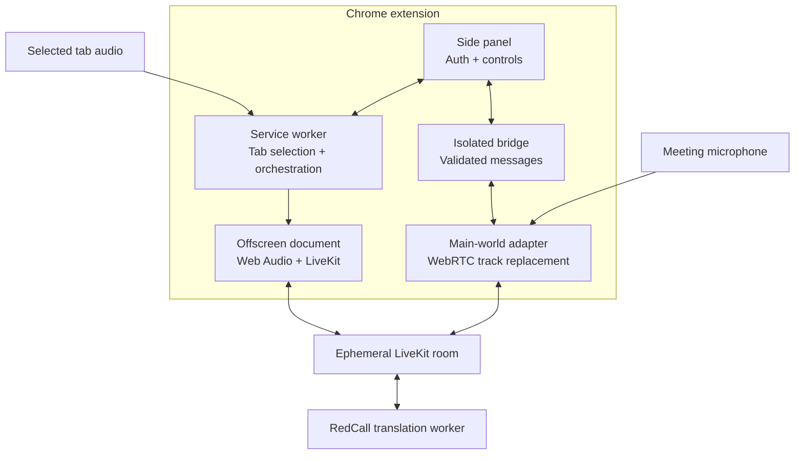
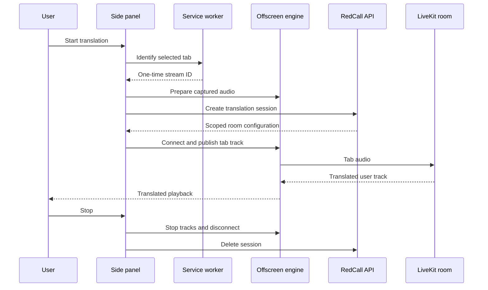

# Architecture

## Component map

## Responsibilities

| Component           | Responsibility                                                                                    | Trust boundary                                        |
| ------------------- | ------------------------------------------------------------------------------------------------- | ----------------------------------------------------- |
| `sidepanel.js`      | PKCE login, RedCall API calls, language/voice selection, lifecycle UI                             | Extension origin                                      |
| `service-worker.js` | Remembers the user-selected tab, obtains capture stream IDs, creates the offscreen document       | Extension background context                          |
| `offscreen.js`      | Captures and conditions audio, publishes tracks, plays translated audio, releases media resources | Extension origin with media privileges                |
| `content-bridge.js` | Relays a narrow message set between the extension and the page                                    | Isolated content-script world                         |
| `site-adapter.js`   | Wraps WebRTC creation and replaces outgoing audio senders                                         | Main page world; assume page scripts can observe data |
| RedCall API         | Authenticates devices and creates scoped translation sessions                                     | Server boundary; not included here                    |
| Translation worker  | Consumes and produces named audio tracks                                                          | Server boundary; not included here                    |

## Listen-mode lifecycle

## Bidirectional safety invariant

When bidirectional translation is active, an outgoing audio sender must use either:

1. the translated remote track; or
2. a generated silent track.

It must not fall back automatically to the original microphone. The adapter therefore intercepts
later `replaceTrack()` calls from meeting applications, mirrors their mute state, and restores the
original track only during an explicit stop operation.

## Audio pipeline

The tab and microphone publication paths apply:

1. an 85 Hz high-pass filter;
2. a presence boost around 2.6 kHz;
3. dynamic-range compression;
4. mono 48 kHz WebRTC publication with redundancy enabled.

Translated playback uses a limiter. When the translation is speaking, automatic ducking lowers any
reinjected original tab audio and restores it smoothly afterward.

## Security decisions

- No remote JavaScript is loaded; extension pages use `script-src 'self'`.
- Host access is restricted to the RedCall API and explicitly supported meeting origins.
- The LiveKit browser grants must be short-lived and room-scoped by the server.
- The main-world token must be subscribe-only because page scripts share that world.
- Provider credentials remain server-side.
- The client stores sessions in `chrome.storage.local`, never in sync storage.
